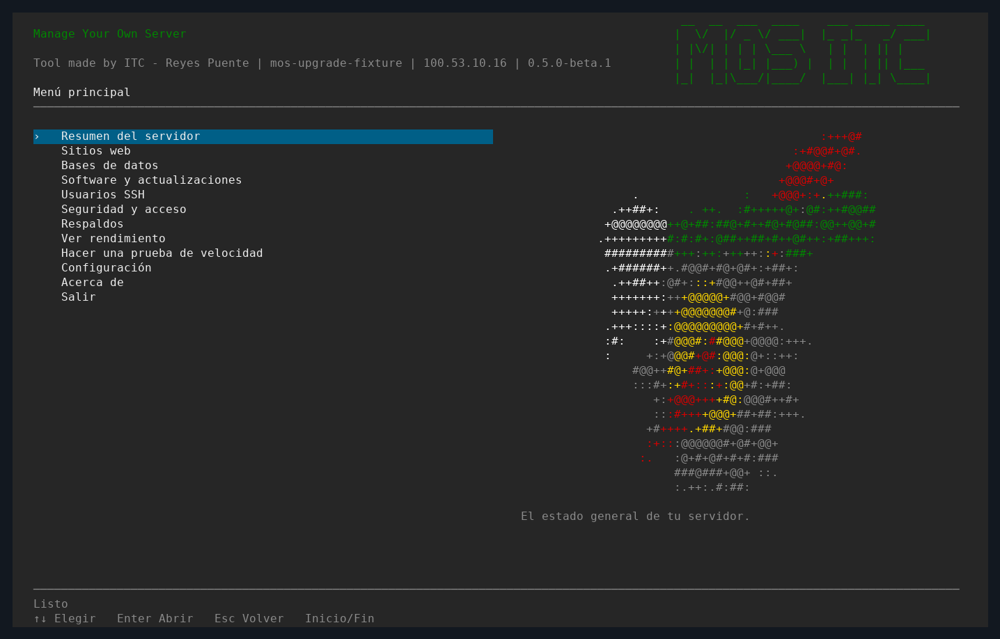

# MOS ITC

**Tu servidor, desde la terminal.**

Manage your Own Server · Instituto Tecnológico de Celaya

[](https://github.com/reyespuente/mos-itc/actions/workflows/checks.yml)
[](LICENSE)

Un panel CLI para administrar servidores Debian y Ubuntu por SSH.
Menús con flechas, sin navegador ni panel web.



## Qué puedes hacer

- Instalar y configurar Apache, PHP-FPM y herramientas para tus aplicaciones.
- Crear sitios, asignar certificados y gestionar HTTPS.
- Administrar bases MariaDB y PostgreSQL, usuarios y permisos por base.
- Crear administradores y usuarios Linux para estudiantes; configurar SSH, firewall y Fail2ban.
- Configurar respaldos S3, SFTP o FTP/FTPS, elegir horarios y recuperar copias.
- Consultar registros, usar una terminal SQL y descargar copias con enlaces temporales.
- Ver gráficos de rendimiento en vivo y ejecutar antivirus.

Disponible en español e inglés.

## Instalar

En el servidor, descarga el instalador de una versión publicada:

```bash
curl -fL https://raw.githubusercontent.com/reyespuente/mos-itc/v0.5.0-beta.1/install.sh -o install-mos-itc.sh
sudo bash install-mos-itc.sh --repo reyespuente/mos-itc --ref v0.5.0-beta.1
sudo mos-itc --language es
```

El instalador pide confirmación y aceptar la licencia. El servidor web y las bases
se instalan después, desde el menú. Para actualizar una instalación existente,
agrega `--upgrade` al comando del instalador.

**Versión beta.** Empieza en una VM y conserva respaldos de tus datos. El punto
de recuperación del instalador guarda configuración; no es una copia completa
del servidor.

## Probar sin instalar

```bash
python3 -m mos_itc --dry-run --language es
```

[Administrar el servidor](docs/ADMINISTRATION.md) · [Configurar respaldos](docs/BACKUPS.md) · [Guía completa](docs/GUIDE.md) · [Inicio rápido](LEEME.md) ·
[Pruebas realizadas](TEST_RESULTS.md) · [Seguridad](SECURITY.md) ·
[Contribuir](CONTRIBUTING.md) · [Licencia MIT](LICENSE)
