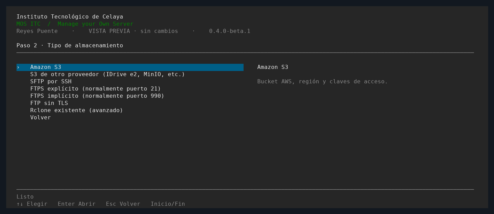

# Respaldos en MOS ITC

MOS usa Restic para cifrar y versionar las copias, y Rclone para conectar el
almacenamiento. La configuración se hace con formularios; no necesitas editar INI.



## Primer respaldo

1. Abre **Respaldos → Agregar almacenamiento · asistente**.
2. Pon un ID corto (por ejemplo `idrive`) y un nombre para identificarlo.
3. Elige Amazon S3, S3 compatible, SFTP, FTPS explícito, FTPS implícito, FTP o
   una configuración Rclone que ya exista en el servidor.
4. Introduce los datos del proveedor. Elige una carpeta o prefijo exclusivo
   para este repositorio. En S3 el bucket debe existir. No uses el prefijo de
   otro repositorio a menos que quieras conectarlo con su contraseña original.
5. Define la contraseña **Restic** y guárdala también fuera del servidor. Esta
   contraseña cifra las copias; es distinta del acceso al almacenamiento.
6. Elige qué incluir y revisa el resumen. MOS guarda la configuración en privado.
7. El asistente prueba escribir, leer y eliminar un objeto temporal en ese destino.
8. Elige **Crear repositorio NUEVO** o **Conectar repositorio EXISTENTE**. Para
   uno existente necesitas su contraseña Restic original. Inicializar no crea
   una copia de los datos ni reemplaza un repositorio existente.
9. Entra al destino y elige **Respaldar ahora**. Comprueba el resultado y abre
   **Copias disponibles y restauración** para ver la instantánea nueva.
10. Configura el horario cuando la primera copia y una restauración de prueba
    hayan funcionado.

Si una conexión falla, el perfil queda guardado. Usa **Reconfigurar conexión**
para corregirlo; puedes conservar la contraseña Restic dejándola vacía. El
contenido seleccionado se conserva. Cambiar la ubicación desactiva el horario
para que revises el destino antes de programarlo otra vez. No se borran copias.

## Datos de cada almacenamiento

| Tipo | Datos |
|---|---|
| Amazon S3 | Bucket existente, prefijo, región, Access Key ID y Secret Access Key |
| S3 compatible | Endpoint HTTPS de la API, bucket, prefijo, región si corresponde y claves del proveedor |
| SFTP | Servidor, puerto (normalmente 22), usuario, directorio, contraseña o llave privada guardada en el servidor |
| FTPS explícito | Servidor, puerto (normalmente 21), usuario, contraseña y directorio |
| FTPS implícito | Los mismos datos, normalmente en el puerto 990 |
| FTP | Los mismos datos, normalmente en el puerto 21; las credenciales viajan sin TLS |
| Rclone existente | Archivo de configuración del servidor y destino `rclone:remoto:carpeta` |

Ejemplo de **S3 compatible** para IDrive e2: endpoint
`s3.us-west-2.idrivee2.com`, bucket existente y un prefijo propio, como
`mos-itc/investigacion`. Introduce tus claves en el formulario secreto, nunca
en comandos, el README o un issue de GitHub.

En SFTP el asistente muestra las huellas del servidor. Verifícalas con el
administrador antes de aceptarlas; un cambio posterior se rechaza. La llave
privada debe estar en el servidor que ejecuta MOS, no solo en tu computadora.
Los archivos de conexión se guardan bajo `/etc/mos-itc/backups/ID/`, solo para root.
La ofuscación de contraseñas que usa Rclone no es cifrado seguro de esos archivos.

S3 y FTPS verifican TLS. Si tu organización usa una CA privada, el asistente
permite seleccionar un archivo PEM de confianza; no se desactiva la validación.
FTP cifra el contenido con Restic, pero deja expuestas las credenciales de FTP
en tránsito: prefiere FTPS o SFTP cuando puedas.

En IDrive e2 MOS prepara cargas multipartes con MD5 en metadatos, porque el
ETag del proveedor puede no representar el MD5 del contenido. No cambia el
cifrado del bucket ni desactiva la verificación del contenido; Restic verifica
también los datos cifrados al recuperarlos. La inicialización tiene un límite
de tres minutos, en vez de dejar una configuración esperando indefinidamente.

MOS detectó un bloqueo de restauración SFTP con Rclone 1.60.1 de Ubuntu. Los
transportes de archivos usan como base probada Rclone 1.76.0. Si hace falta, el
asistente ofrece descargar ese componente oficial por HTTPS, comprobar SHA-256
e instalarlo en `/usr/local/lib/mos-itc/rclone`. No reemplaza el paquete APT,
no se actualiza solo y se conserva al actualizar MOS. Una versión del sistema
que cumpla la base también se puede usar. La comprobación SHA-256 no equivale a
verificar una firma del editor.

## Qué incluye

| Perfil | Contenido |
|---|---|
| Recomendado | `/etc`, `/var/lib/mos-itc`, `/srv/mos/sites` y exportaciones SQL de los motores locales detectados |
| Solo sitios | Archivos de `/srv/mos/sites`; no exporta bases |
| Solo bases | SQL de MariaDB y de los clústeres PostgreSQL locales detectados |
| Personalizado | Carpetas seleccionadas, rutas adicionales y bases si se activan |

No es una imagen del disco. `/home` y `/root` solo se incluyen si los seleccionas.
Se excluye la caché de Restic. Cada copia contiene un `MOS-RESTORE.json` dentro de
`var/lib/mos-itc/backup-staging/ID`, con las rutas y exportaciones SQL de esa copia.
Si falta una carpeta seleccionada o falla la exportación, la copia se marca como
fallida; no se omite silenciosamente. Un clúster PostgreSQL detectado pero detenido
impide declarar completo un respaldo de bases.

Los archivos pueden cambiar durante el respaldo. MariaDB usa una exportación
transaccional; tablas no transaccionales y cambios de estructura necesitan
coordinación. PostgreSQL exporta cada clúster por su puerto. No hay una instantánea
atómica conjunta de archivos, motores y aplicaciones.

## Horarios y estado

En el destino, abre **Horario y frecuencia**. Puedes elegir diario, cada lunes,
o cada 1, 2, 3, 4, 6, 8 o 12 horas. Los intervalos se alinean a medianoche. Se usa
la zona horaria actual del servidor, con hasta 60 segundos de demora aleatoria.
systemd recupera una ejecución pendiente después de un arranque. Puedes desactivar
la programación desde el mismo menú.

Cada destino tiene su propio timer: `mos-backup-ID.timer`. Los perfiles no quedan
en una cola indefinida: un conflicto se informa como error. El bloqueo general
de cambios de MOS solo se toma durante la preparación local de los SQL y los
cambios de configuración, no durante toda la transferencia.

**Resumen** muestra la última operación y el último respaldo completado.
**Últimas operaciones** registra resultados, duración y errores sin credenciales.
Un proceso interrumpido se identifica por PID, arranque y tiempo de inicio del
proceso, para no dejar un estado de ejecución permanente después de un reinicio.

No se eliminan instantáneas antiguas automáticamente. Define una política de
conservación antes de que crezca el repositorio; no borres sus objetos a mano.

## Restaurar

1. Abre el destino → **Copias disponibles y restauración**.
2. Selecciona una fecha. Puedes consultar el equipo y las rutas de esa copia.
3. Elige **Restaurar esta copia** y un directorio nuevo bajo `/srv`.
4. MOS extrae y verifica los archivos, sin sobrescribir el servidor activo.
5. Revisa `MOS-RESTORE.json`, archivos y permisos antes de recuperar servicios.

Las bases son archivos SQL: no se importan automáticamente sobre las bases
activas. Primero prueba la importación en un motor aislado. Una copia de archivos
no reinstala paquetes, crea usuarios Linux ni activa certificados o servicios
por sí sola. Una restauración fallida conserva su carpeta parcial para revisión;
usa una carpeta nueva al reintentar. Guarda la contraseña Restic fuera del servidor.

## Bloqueos y reparación

En **Comprobar y solucionar problemas** tienes conexión, inicialización, comprobación
de estructura, verificación completa, consulta de bloqueos y limpieza de bloqueos
obsoletos. La verificación completa lee los datos y puede consumir tráfico.

Antes de desbloquear, verifica que ningún equipo esté usando el repositorio. MOS
ejecuta `restic unlock` sin `--remove-all` y nunca desbloquea automáticamente.
No puede comprobar los procesos que corren en otros servidores. Los comandos
que esperan un bloqueo remoto lo reintentan como máximo 30 segundos cuando la
versión de Restic ofrece esa opción.

La reparación del índice es avanzada y requiere escribir `REPAIR`. Úsala solo
si una comprobación indica daño y después de conservar una copia del repositorio
o al menos de sus índices e instantáneas. No recupera bloques que se hayan perdido.

## CLI

```bash
sudo mos-itc backup configure
sudo mos-itc backup run --repository idrive
sudo mos-itc backup snapshots --repository idrive
sudo mos-itc backup check --repository idrive
sudo mos-itc backup restore /srv/mos-recuperado --repository idrive --snapshot ID_COMPLETO
```

La configuración anterior de un único repositorio se sigue leyendo como `legacy`.
Su contraseña y tareas antiguas se conservan; las nuevas tareas siempre indican
el ID del destino. Para cambiar el contenido de una configuración anterior, crea
un perfil nuevo que conecte el mismo repositorio con su contraseña original.

Referencias: [Restic](https://restic.readthedocs.io/en/stable/),
[Rclone S3](https://rclone.org/s3/), [SFTP](https://rclone.org/sftp/) y
[FTP/FTPS](https://rclone.org/ftp/).
